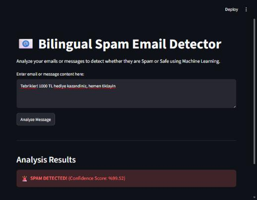

# Spam Detector (TR + EN)

[](https://github.com/iamehmetozdemir/spam-detector/actions/workflows/tests.yml)

[English](#english) · [Türkçe](#türkçe)

**Live demo:** https://iamehmetozdemir.github.io/spam-detector/



## English

A spam classifier that works on Turkish and English messages. I made it while learning machine learning. It turns text into TF-IDF features (words, word pairs and character n-grams) and classifies it with Logistic Regression. There's a FastAPI endpoint, a small Streamlit page, and a demo page that runs the same model directly in the browser.

### Run it

```bash
pip install -r requirements.txt
python main.py                  # train: model selection + final test (needs emails.csv, see Datasets)
python evaluate.py              # charts and error list in reports/
uvicorn api:app --reload        # API on http://127.0.0.1:8000
streamlit run frontend.py       # UI, needs the API running
```

The trained model files are already in the repo, so you can skip training and start the API.

```bash
curl -X POST http://127.0.0.1:8000/predict -H "Content-Type: application/json" \
  -d '{"text": "Tebrikler! 1000 TL hediye kazandiniz, hemen tiklayin"}'
# {"prediction":"Spam","email_text":"...","confidence":99.24,"spam_probability":0.9924}
```

### How I trained and checked it

1. The data (10,435 messages after removing duplicates) is split 80/20, keeping the share of each language and of spam the same on both sides.
2. Models are compared **only on the training part** with 5-fold cross-validation: Naive Bayes and Logistic Regression, with and without character n-grams, a few settings each. The vectorizer is fit inside each fold, so nothing leaks between folds. Full table: [reports/model_selection.md](reports/model_selection.md).
3. The best one (Logistic Regression, words + characters, C=10, CV F1 0.9955) is retrained on the whole training part and evaluated **once** on the test part.

| Test set (2,087 messages) | Accuracy | Precision | Recall | F1 |
|---|---|---|---|---|
| All | 0.996 | 0.995 | 0.994 | 0.994 |
| English e-mails | 0.995 | 0.989 | 0.989 | 0.989 |
| Turkish SMS | 0.997 | 0.998 | 0.996 | 0.997 |

Things I found along the way:
- My first model was Naive Bayes and it missed almost half of the English spam. Logistic Regression fixed that. Interestingly, adding character n-grams makes Naive Bayes *worse* (CV F1 0.97 → 0.94) while it makes Logistic Regression better.
- The learning curve is still going up at the full training size, so more data would probably help a bit more ([reports/learning_curve.png](reports/learning_curve.png)).
- The probabilities are well calibrated (Brier score 0.005, [reports/calibration.png](reports/calibration.png)), which matters because the API returns them as "confidence".
- Only 9 test messages are wrong. Most missed spam is short and odd, and one Turkish "spam" looks like a normal invitation ([reports/errors.md](reports/errors.md)).

Still, both datasets are fairly easy and come from one source each. An English SMS or a Turkish e-mail is something the model has never seen, so real-world accuracy would be lower.

### The browser demo

GitHub Pages can't run Python, so `export_web_model.py` saves the vocabulary and weights to `docs/model.json`, and `docs/spam-model.js` redoes the vectorizer and the classifier in JavaScript. On all 2,096 test cases the JavaScript and Python probabilities match to about 0.0000003, with no label changes. A test runs the JavaScript in Node and checks this on every push. Run `python export_web_model.py` after retraining.

### Tests

`pip install -r requirements-dev.txt` and then `pytest`: API responses and input validation, that the exported weights reproduce the model, that the JavaScript port matches Python (if Node is installed), and the data split (if `emails.csv` is there). GitHub Actions runs them on every push.

### Datasets

- English: [Spam Email Dataset](https://www.kaggle.com/datasets/jackksoncsie/spam-email-dataset) (`emails.csv`, ~9 MB, not in the repo, download it and put it next to `main.py`)
- Turkish: [Turkish SMS Collection](https://www.kaggle.com/datasets/onurkarasoy/turkish-sms-collection) (`TurkishSMSCollection.csv`, included)

Check their licenses on Kaggle before reusing. The code here is MIT.

## Türkçe

Türkçe ve İngilizce mesajlarda çalışan bir spam sınıflandırıcı. Makine öğrenmesini öğrenirken yaptım. Metni TF-IDF özelliklerine (kelimeler, kelime çiftleri, karakter n-gram'ları) çevirip Logistic Regression ile sınıflandırıyor. Bir FastAPI uç noktası, küçük bir Streamlit sayfası ve aynı modeli doğrudan tarayıcıda çalıştıran bir demo sayfası var.

### Çalıştırma

```bash
pip install -r requirements.txt
python main.py                  # eğitim: model seçimi + son test (emails.csv lazım)
python evaluate.py              # grafikler ve hata listesi reports/ içine
uvicorn api:app --reload        # API: http://127.0.0.1:8000
streamlit run frontend.py       # arayüz, API açık olmalı
```

Eğitilmiş model dosyaları repoda hazır, eğitimi atlayıp direkt API'yi açabilirsin.

### Nasıl eğittim ve kontrol ettim

1. Veri (tekrarlar atılınca 10.435 mesaj) %80/%20 bölünüyor; iki tarafta da dil ve spam oranları aynı kalıyor.
2. Modeller **sadece eğitim kısmında** 5 katlı çapraz doğrulamayla karşılaştırılıyor: Naive Bayes ve Logistic Regression, karakter n-gram'lı ve n-gram'sız, birkaç farklı ayarla. Vektörleştirici her katın içinde eğitiliyor, yani katlar arasında bilgi sızmıyor. Tam tablo: [reports/model_selection.md](reports/model_selection.md).
3. En iyisi (Logistic Regression, kelime + karakter, C=10, CV F1 0,9955) tüm eğitim kısmıyla yeniden eğitilip test kısmında **bir kez** değerlendiriliyor. Sonuçlar yukarıdaki tabloda: genel doğruluk 0,996, İngilizce F1 0,989, Türkçe F1 0,997.

Yol boyunca bulduklarım:
- İlk modelim Naive Bayes'ti ve İngilizce spam'in neredeyse yarısını kaçırıyordu, Logistic Regression bunu düzeltti. İlginç olan: karakter n-gram'ları Logistic Regression'ı iyileştirirken Naive Bayes'i *kötüleştiriyor* (CV F1 0,97 → 0,94).
- Öğrenme eğrisi tam veri boyutunda hâlâ yükseliyor, yani daha fazla veri biraz daha işe yarar.
- Olasılıklar iyi kalibre (Brier skoru 0,005). API bunları "confidence" olarak döndürdüğü için bu önemli.
- Test kümesinde sadece 9 mesaj yanlış. Kaçan spam'lerin çoğu kısa ve tuhaf; bir Türkçe "spam" de normal bir davet gibi duruyor ([reports/errors.md](reports/errors.md)).

Yine de iki veri seti de oldukça kolay ve her biri tek kaynaktan. İngilizce bir SMS ya da Türkçe bir e-posta modelin hiç görmediği şeyler, gerçek hayatta doğruluk daha düşük olur.

### Tarayıcı demosu

GitHub Pages Python çalıştıramıyor. O yüzden `export_web_model.py` sözlüğü ve ağırlıkları `docs/model.json`'a kaydediyor, `docs/spam-model.js` de vektörleştiriciyi ve sınıflandırıcıyı JavaScript'te yeniden yapıyor. Test kümesinin tamamında (2.096 örnek) JavaScript ve Python olasılıkları yaklaşık 0,0000003 farkla aynı, hiçbir etiket değişmiyor. Bir test JavaScript'i Node'da çalıştırıp bunu her push'ta kontrol ediyor.

### Testler

`pip install -r requirements-dev.txt`, sonra `pytest`: API yanıtları ve girdi kontrolü, dışa aktarılan ağırlıkların modeli birebir üretmesi, JavaScript sürümünün Python'la aynı sonucu vermesi (Node kuruluysa) ve veri bölme (`emails.csv` varsa). GitHub Actions her push'ta çalıştırıyor.

### Veri setleri

- İngilizce: [Spam Email Dataset](https://www.kaggle.com/datasets/jackksoncsie/spam-email-dataset) (`emails.csv`, ~9 MB, repoda yok, indirip `main.py`'nin yanına koy)
- Türkçe: [Turkish SMS Collection](https://www.kaggle.com/datasets/onurkarasoy/turkish-sms-collection) (`TurkishSMSCollection.csv`, repoda var)

Kullanmadan önce Kaggle'daki lisanslarına bak. Buradaki kod MIT lisanslı.
